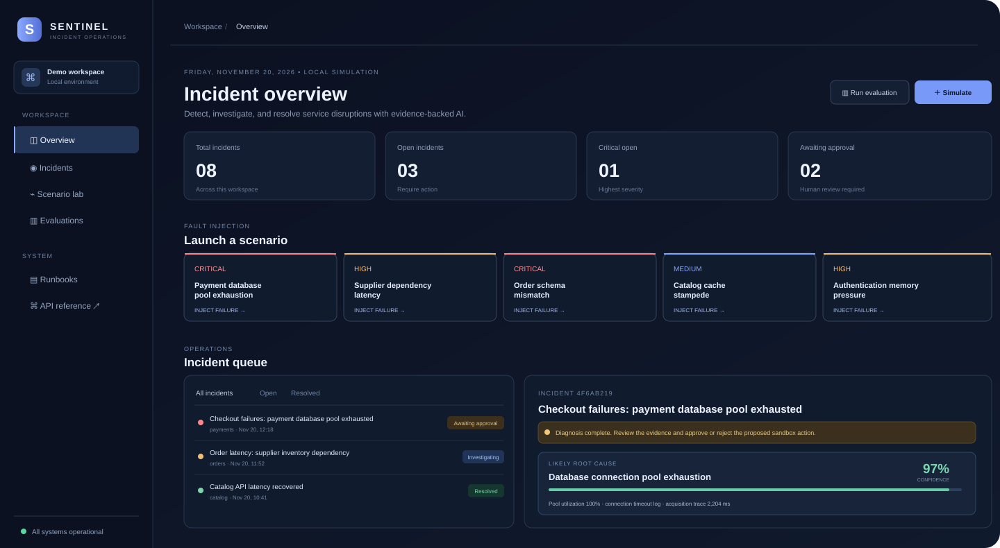

# Sentinel — evidence-grounded incident investigation

Sentinel ingests incident telemetry (metrics, logs, traces, deployments), scores a catalogue of declarative diagnostic rules against it, and either
**cites the evidence for a root cause or abstains**. It then proposes a remediation, checks it against policy, and — only after an authenticated
human approves — applies it to a **simulated** configuration store with a verified rollback. Every step lands in a hash-chained audit log.

> **Scope, stated plainly.** Sentinel never touches real infrastructure. Telemetry comes from bundled synthetic fixtures *or* from data you POST to it
> (JSON, or an OTLP/JSON subset). Remediation is a sandbox simulation. The diagnosis engine is a transparent rule catalogue, **not** a machine-learning
> model; an LLM is optional and can only pick which read-only tools to call. See [Limitations](#limitations) and [docs/EVALUATION.md](docs/EVALUATION.md).



## What is in the box

| Area | What it does |
|---|---|
| **Diagnosis** | Declarative weighted-signal rules ([`agent/rules.py`](backend/app/agent/rules.py)). Normalises units/scales, matches name *patterns* not exact strings, requires an anchor signal plus ≥2 independent telemetry kinds, and **abstains** on thin or conflicting evidence. Every claim cites evidence IDs. |
| **Adversarial input** | Telemetry is data. Instruction-like text is excluded from rule matching and surfaced as a warning; a single forged log cannot create a diagnosis. Secrets/PII are redacted at ingest and again before anything reaches a model. |
| **Optional LLM** | `SENTINEL_ENABLE_LLM_AGENT`: model chooses *which* of 5 read-only tools to call (allowlist, once each, ≤6 calls, untrusted-content envelope, retries + circuit breaker). `SENTINEL_ENABLE_MODEL_SYNTHESIS`: advisory text only. Neither can change the diagnosis or approve anything. Both are tested against a scripted hostile model. |
| **Remediation** | Structured proposals → policy-as-code (allowlisted actions, numeric bounds, additive-only migrations) re-evaluated at approval → atomic compare-and-swap approval → sandbox apply with drift detection → explicit rollback. |
| **Auth & RBAC** | API keys (only SHA-256 hashes configured), roles `viewer < operator < approver`, identity taken from the credential (never the request body), optional four-eyes (approver ≠ creator/investigator), failed-auth throttling, per-principal rate limit. |
| **Audit** | Append-only table (SQL triggers) **and** a SHA-256 hash chain; `GET /api/audit/verify` detects edits, mid-chain deletion and reordering. |
| **Ingestion** | `POST /api/incidents/ingest` (validated, size-capped, idempotent via `external_id`) and `/ingest/otlp` (spans, log records, gauge/sum metrics). |
| **Operations** | App factory, versioned DB migrations, `/api/health` + `/api/ready`, Prometheus `/metrics`, JSON logs with request IDs, security headers/CSP, body-size limit, non-root read-only container. |
| **Evaluation** | 53 cases in three splits, reported with wrong-diagnosis rate, abstention precision/recall, calibration error and evidence precision/recall; CI fails on regression. |
| **Quality gates** | 347 tests, 94% branch coverage (gate 90%), ruff, mypy, `pip-audit`, metamorphic/property tests, mutation-checked security controls. |

## Quick start

```bash
python -m venv .venv && source .venv/bin/activate        # Windows: .venv\Scripts\Activate.ps1
python -m pip install -r requirements-dev.txt
make run                                                  # uvicorn backend.app.main:create_app --factory
```

Open <http://127.0.0.1:8000>. In development, authentication is **off** (every request acts as `local-operator`; a warning is logged) and the scenario
launcher is enabled. Then: launch a scenario → **Run investigation** → review evidence, warnings and the policy result → **Approve & simulate** → try **Roll back**.

```bash
make test        # 347 tests
make cov         # with branch-coverage gate
make lint typecheck
make evaluate    # metrics summary;  make evaluate-check  = CI regression gate
```

### Bring your own telemetry

```bash
curl -X POST localhost:8000/api/incidents/ingest -H 'Content-Type: application/json' -d '{
  "external_id": "alert-1042", "title": "Ledger writes stalling", "service": "ledger", "severity": "high", "summary": "writes failing",
  "telemetry": [
    {"kind":"metric","service":"ledger","payload":{"name":"db_pool_utilization","value":99,"unit":"percent","threshold":85}},
    {"kind":"log","service":"ledger","payload":{"level":"ERROR","code":"DB_POOL_TIMEOUT","message":"Timed out waiting to acquire a database connection"}}
  ]}'
curl -X POST localhost:8000/api/incidents/<id>/investigate
```

### Production-like run

```bash
python scripts/create_api_key.py alice approver        # prints the raw key once + the config entry
export SENTINEL_ENV=production
export SENTINEL_API_KEYS="alice:approver:<sha256-from-script>,olga:operator:<...>"
uvicorn backend.app.main:create_app --factory --host 0.0.0.0 --port 8000 --proxy-headers
```

`SENTINEL_ENV=production|staging` **refuses to start** without keys, rejects wildcard CORS, hides `/docs` and the demo simulators, enables HSTS and four-eyes.
Docker: `docker compose up --build` (development mode, loopback-only); see the comments in [`docker-compose.yml`](docker-compose.yml) for the production-like variant.

## API at a glance

| Role | Endpoints |
|---|---|
| public | `GET /` · `GET /api/health` · `GET /api/ready` · `GET /api/config` |
| viewer | `GET /api/dashboard\|incidents\|incidents/{id}\|runbooks\|audit/verify\|me` · `GET /metrics` |
| operator | `POST /api/incidents/ingest` · `POST /api/incidents/ingest/otlp` · `POST /api/incidents/{id}/investigate` · `POST /api/evaluations/run` · demo endpoints |
| approver | `POST /api/incidents/{id}/remediations/{rid}/approve\|reject\|rollback` |

Errors are JSON `{"detail", "code", ...}`; unexpected failures never leak internals (only a `request_id`). Interactive docs at `/docs` in development.

## Design decisions

- **Rules over a model for the verdict.** Debuggable, free to run, cites evidence, and *abstains*. The ADRs explain the trade-off
  ([0001](docs/adr/0001-deterministic-diagnosis-baseline.md), [0002](docs/adr/0002-declarative-rules-and-abstention.md)).
- **Safety is structural, not prompt-based.** Read-only tools, allowlists, policy, CAS approvals and RBAC hold even if the model or the telemetry is hostile.
- **Honest scores.** `confidence` is an *evidence-coverage score*, not a probability; its calibration error is measured and published.
- **Single-node by design.** SQLite + in-process limiter keep it zero-dependency; the limits of that choice are documented under Operations.

## Limitations

- **Not validated on real incidents.** All evaluation data is synthetic and author-written; the held-out split was used during development. Treat results as a
  regression/robustness signal. See [docs/EVALUATION.md](docs/EVALUATION.md) for the first-run probe result (6/12) before the rules were widened.
- **Five failure classes** (pool exhaustion, dependency latency, schema mismatch, cache stampede, memory pressure). Anything else abstains — by design.
  Vocabulary is regex-based and will miss stacks it has not seen (the probe set shows this).
- **Cannot tell cause from symptom.** When a dependency slowdown saturates a pool, both hypotheses are supported and Sentinel abstains.
- **Simulation only.** No real executor exists; the sim store is a table. The migration action is parsed and policy-checked, never run.
- **Single instance.** SQLite with one guarded connection, in-memory rate limiting, no HA. Moving to PostgreSQL is a stated next step, not done.
- **Container image is untested in this build environment** (no Docker daemon available); CI builds and smoke-tests it.
- The OTLP adapter is JSON-only and a subset (no gRPC/protobuf, histograms, or exemplars).

## Repository layout

```text
backend/app/
  main.py            app factory, routes, error handling      security.py     auth, RBAC, rate limit, body limit, headers
  config.py          validated settings (fails closed)         observability.py  JSON logs, request IDs, Prometheus
  db.py              migrations, CAS transitions, audit chain  redaction.py    secrets/PII + injection heuristics
  agent/             rules.py · diagnosis.py · runtime.py · tools.py · remediation.py · llm_client.py · llm_tool_agent.py · llm_review.py
  services/          incidents · otlp · policy · remediation · evaluation · runbooks · demo_services
  data/              scenarios.json (dev) · eval/heldout.json · eval/probe.json · runbooks.json
frontend/            dependency-free dashboard           scripts/   evaluation CLI, API-key generator, smoke test, dataset builder
tests/               347 tests                           docs/      architecture, evaluation, security, operations, ADRs, resume notes
```

MIT licensed.
