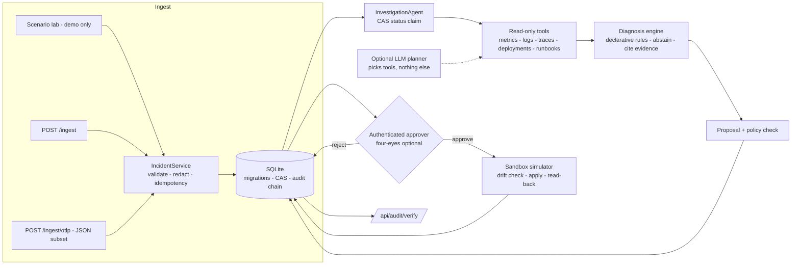

# Architecture

## Goals

1. Make an AI-assisted investigation **inspectable and reproducible**: every claim cites telemetry, and the system says "I don't know" when it should.
2. Keep **diagnosis, proposal, and execution separate**, so a compromised input or model cannot turn a diagnosis into an action.
3. Be runnable with one command and no external services, while leaving clear seams for real infrastructure.

## Components

| Component | Responsibility | Boundary |
|---|---|---|
| `main.create_app` | Builds an isolated `Services` container per app; routes, error mapping, middleware | No work at import time; tests build many apps |
| `security.py` | API-key auth, RBAC dependencies, token buckets, body limit, security headers | Identity is attached to `request.state`; never read from bodies |
| `config.Settings` | Typed env config, validated at startup | Unsafe combinations fail closed |
| `services/incidents.py` | One creation path for synthetic, API and OTLP incidents; redaction; idempotency | Telemetry is sanitised before it is stored |
| `services/otlp.py` | OTLP/JSON subset → normalised records | Tolerates malformed input |
| `agent/runtime.py` | Orchestrates tool calls → diagnosis → proposal → status transition | Claims the incident with a CAS; on failure restores state and audits |
| `agent/tools.py` | Read-only accessors over stored telemetry | Explicit dispatch table; no dynamic lookup |
| `agent/rules.py` + `diagnosis.py` | Rule catalogue + scoring/abstention | Pure functions of the evidence; no I/O |
| `agent/llm_*` | Optional planner/reviewer over an injectable HTTP transport | Allowlist, budgets, untrusted envelope, breaker, fallback |
| `services/policy.py` | Policy-as-code over proposals | Evaluated at proposal time *and* approval time |
| `services/remediation.py` | Approve/reject/rollback with CAS, four-eyes, drift detection | Writes only to the simulated config table |
| `db.py` | Migrations, CAS helpers, hash-chained audit | One guarded connection; WAL |
| `services/evaluation.py` | Replays cases through the production path; metrics | Isolated temp databases |

## Investigation lifecycle

1. Incident is created (scenario / `ingest` / `ingest/otlp`). Payloads are validated, **redacted**, stored, and an `incident.detected` audit event records redaction counts.
2. `investigate` atomically moves the incident `detected|diagnosed|awaiting_approval → investigating` (second concurrent caller gets 409).
3. Four read-only tools collect evidence (an optional LLM may choose their order; missing ones are filled deterministically).
4. `diagnose()`:
   1. excludes instruction-like records (reported as warnings);
   2. scores each rule: matched signal weight ÷ total weight;
   3. a cause is **eligible** only with an anchor signal, score ≥ 0.6 and ≥ 2 independent telemetry kinds;
   4. if two eligible causes are within 0.15 → **abstain** (`conflicting_hypotheses`); if none → abstain (`insufficient_evidence`) and list what to collect.
5. A structured proposal is created and evaluated against policy; previous open proposals are marked `superseded`.
6. Status becomes `awaiting_approval` (diagnosed) or `diagnosed` (abstained; nothing approvable).
7. An approver approves → re-check policy → CAS `proposed→approved` → simulate (drift check, apply, read-back) → `executed_in_sandbox`; or rejects; or later rolls back.
8. Every transition appends to the hash-chained audit log.

## Data model

`incidents` (status, source, external_id, created_by) · `telemetry` · `agent_runs` (trace + diagnosis snapshot) · `remediations` (proposal, status, audit) ·
`audit_events` (append-only, `prev_hash`, `hash`) · `sim_config` (simulated configuration) · `schema_migrations`.
Schema evolves through numbered forward-only migrations applied at startup (currently v4).

### Incident status machine

`detected → investigating → {awaiting_approval | diagnosed}` · `awaiting_approval → {simulated | rejected}` · `simulated → rolled_back`.
`simulated`, `rejected`, `rolled_back` cannot be re-investigated.

## Rules: why declarative

A rule is data: signals with a kind, weight, predicate, and an operator-facing hint ("collect: cache hit ratio"). Predicates normalise units and match
name **patterns**; the monitoring system's own `threshold` is preferred over our defaults. Adding a cause = one `CauseRule` entry + a proposal template +
policy bounds. The thresholds (≥90% utilisation, ≤35% hit rate, 1 s slow span, …) are heuristics and are listed in `rules.py`.

## Extension points

| To add | Seam |
|---|---|
| PostgreSQL | `Database` is the only SQL-touching class; implement the same methods (CAS + audit chain are the hard parts) |
| Live telemetry | Extend `services/otlp.py` or add a pull adapter producing the same normalised records |
| New failure class | `rules.py` (+ `remediation.py` template, `policy.py` bounds, runbook, eval cases) |
| Real executor | Replace `RemediationService._simulate`; keep the policy gate, CAS, four-eyes and audit unchanged |
| Shared state | Swap `TokenBucket` for an edge/redis limiter; move SQLite to PostgreSQL before running >1 replica |
